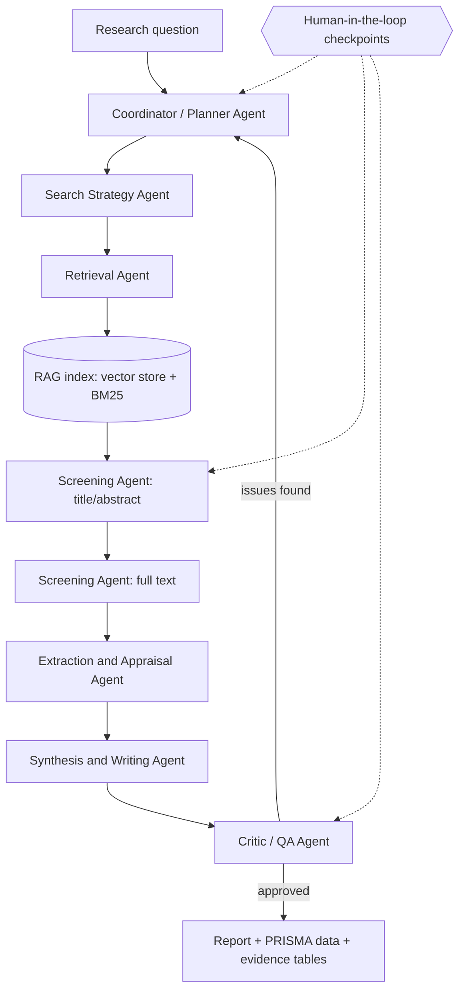

# SR-Agent: An Agentic AI Pipeline for Rigorous, Transparent and Reproducible Systematic Reviews

> Autonomous multi-agent system (LangChain / LangGraph + RAG) that performs an end-to-end, PRISMA 2020-aligned systematic literature review from a single research question.


**Authors:** Hajar Baider<sup>1</sup>, Imane Baider<sup>2</sup><br>
<sup>1</sup> Computer Science and Smart Systems (C3S), Faculty of Sciences and Technologies of Tangier, Abdelmalek Essaadi University<br>
<sup>2</sup> Intelligent Automation and BioMedGenomics, Faculty of Sciences and Technologies of Tangier, Abdelmalek Essaadi University<br>
**Institution:** Faculté des Sciences et Techniques de Tanger, Université Abdelmalek Essaâdi<br>
**Course:** FDO - M1 Agentic AI & Building AI Agents (Formation Doctorale Obligatoire)<br>
**Course instructor:** Pr. Ikram Benabdelouahab<br>


## Table of Contents

1. [Project Overview](#1-project-overview)
2. [Objectives](#2-objectives)
3. [Scope](#3-scope)
4. [System Architecture](#4-system-architecture)
5. [Technology Stack](#5-technology-stack)
6. [Installation](#7-installation)
7. [Configuration](#8-configuration)
8. [Usage](#9-usage)
9. [Pipeline Stages in Detail](#10-pipeline-stages-in-detail)
10. [Transparency, Traceability and Reproducibility](#11-transparency-traceability-and-reproducibility)
11. [Development Log](#14-development-log)
12. [Limitations and Future Work](#15-limitations-and-future-work)
13. [Team and Individual Contributions](#16-team-and-individual-contributions)


---

## 1. Project Overview

Conducting a systematic review manually takes months and is hard to reproduce. SR-Agent designs, implements and evaluates an **autonomous multi-agent AI system** that takes a research question or topic as input and executes the full review process following **PRISMA 2020**: protocol definition, search, screening, data extraction, quality assessment, synthesis and report generation.

Orchestration relies on **LangChain / LangGraph** (agents, tool use, stateful workflow). Grounded reasoning over the retrieved literature relies on **Retrieval-Augmented Generation (RAG)**, so every claim in the output can be traced back to a source document.

## 2. Objectives

- Build a modular multi-agent architecture that autonomously conducts systematic reviews.
- Integrate advanced RAG for accurate retrieval and grounded generation over scientific corpora (PubMed, Semantic Scholar, arXiv, OpenAlex).
- Implement the full PRISMA-aligned workflow, including dual-screening simulation and risk-of-bias assessment.
- Guarantee transparency: logging, citation tracking, decision rationales, reproducible execution traces.
- Support human-in-the-loop oversight at critical decision points.
- Remain general-purpose: any topic, minimal configuration.

## 3. Scope

| Stage | Covered | Notes |
|---|---|---|
| Topic intake and protocol generation | ✅ | PICO / PICOS-style protocol |
| Search strategy design (Boolean, MeSH) | ✅ | <!-- TODO: confirm --> |
| Multi-source retrieval and deduplication | ✅ | <!-- TODO: list implemented sources --> |
| Title/abstract and full-text screening with rationale | ✅ | |
| Structured data extraction and evidence tables | ✅ | |
| Risk-of-bias / quality assessment | ✅ | |
| Narrative synthesis, meta-analysis preparation | ✅ | |
| PRISMA flow data, evidence maps, manuscript draft | ✅ | |
| Persistent memory, versioning, audit trail | ✅ | |

## 4. System Architecture



### Agents

| Agent | Responsibility |
|---|---|
| **Coordinator / Planner** | Decomposes the review into stages, manages state and routing |
| **Search Strategy** | Designs and refines Boolean / MeSH queries per database |
| **Retrieval** | Executes searches, deduplicates, builds and updates the RAG index |
| **Screening (T/A and full text)** | Applies inclusion/exclusion criteria, outputs decision + rationale |
| **Extraction and Appraisal** | Fills structured extraction schema, performs risk-of-bias assessment |
| **Synthesis and Writing** | Produces narrative synthesis, tables and the manuscript draft |
| **Critic / QA** | Checks consistency, bias, completeness and adherence to the protocol |

### RAG pipeline

Hybrid retrieval (dense + sparse) → re-ranking → context compression → grounded generation with citation tracking. <!-- TODO: state your actual embedding model, vector store, chunking size/overlap, reranker -->

## 5. Technology Stack

| Layer | Choice |
|---|---|
| Orchestration | LangChain, LangGraph |
| LLM backbone | <!-- TODO: model(s) used --> |
| Embeddings / vector store | <!-- TODO: e.g. Chroma / FAISS --> |
| Literature APIs | PubMed (E-utilities), Semantic Scholar, arXiv, OpenAlex |
| PDF parsing | <!-- TODO: e.g. PyMuPDF / GROBID --> |
| Exports | Markdown, DOCX, BibTeX |
| Observability | <!-- TODO: e.g. LangSmith / custom JSONL traces --> |


## 6. Installation

**Prerequisites:** Python 3.10+, Git, API key(s) for the LLM provider <!-- TODO: confirm -->.

```bash
# 1. Clone
git clone https://github.com/imanebaider/sr-agent.git
cd sr-agent

# 2. Create a virtual environment
python -m venv .venv
source .venv/bin/activate        # Windows: .venv\Scripts\activate

# 3. Install dependencies
pip install -r requirements.txt
```

## 7. Configuration

```bash
cp .env.example .env
```

| Variable | Description |
|---|---|
| `LLM_API_KEY` | API key for the LLM provider <!-- TODO: real variable name --> |
| `NCBI_API_KEY` | Optional, raises PubMed rate limits |
| `SEMANTIC_SCHOLAR_API_KEY` | Optional |
| `CONTACT_EMAIL` | Used for polite-pool access to OpenAlex |

The review is configured through the protocol template (`config/protocol_template.yaml`): research question, PICO elements, inclusion/exclusion criteria, databases, date range, languages, screening thresholds, human-in-the-loop checkpoints.

> Never commit `.env` or API keys.

## 8. Usage

```bash
python main.py --question "Your research question here" --config config/protocol_template.yaml
```

<!-- TODO: replace with the real entry point and arguments -->

Typical outputs (in `outputs/<run_id>/`):

- `protocol.md`: generated protocol
- `search_strategies.md`: queries per database
- `prisma_flow.json`: PRISMA 2020 flow numbers
- `screening_log.csv`: every decision with rationale
- `evidence_table.csv`: extracted data
- `risk_of_bias.csv`
- `review_draft.md` / `.docx` and `references.bib`
- `trace.jsonl`: full execution trace

## 9. Pipeline Stages in Detail

1. **Protocol generation**: converts the question into PICO elements, eligibility criteria and a registered-style protocol.
2. **Search strategy**: builds and iteratively refines Boolean/MeSH queries per source.
3. **Retrieval and deduplication**: multi-source retrieval, DOI/title-based deduplication, RAG index construction.
4. **Screening**: title/abstract then full text; two simulated independent reviewers, conflicts resolved by an arbiter; every decision carries a rationale.
5. **Extraction and appraisal**: schema-based extraction and risk-of-bias assessment <!-- TODO: name the tool, e.g. RoB 2, ROBINS-I, CASP -->.
6. **Synthesis**: narrative synthesis, evidence maps, meta-analysis-ready data.
7. **Report generation**: manuscript draft with PRISMA checklist validation.
8. **Critic / QA**: consistency and protocol-adherence checks, with re-routing when issues are detected.

## 10. Transparency, Traceability and Reproducibility

- **Decision rationales** stored for each screening and extraction decision.
- **Citation tracking**: each generated statement is linked to its source passage.
- **Execution traces**: prompts, retrieved documents and intermediate artifacts are logged.
- **Versioning**: each run has a unique `run_id`, a frozen config snapshot, model name/version and random seeds.
- **Audit trail**: all human interventions are logged with timestamp.


## 11. Development Log

| Step | Description | Lead | Date |
|---|---|---|---|
| 1 | Requirements analysis and architecture design | Both | <!-- TODO --> |
| 2 | Environment setup and API integration | Hajar | |
| 3 | RAG pipeline (indexing, hybrid retrieval, reranking) | Hajar | |
| 4 | Agent implementation | Imane / Hajar | |
| 5 | LangGraph workflow and state management | Imane | |
| 6 | Logging, tracing and versioning | Imane | |
| 7 | Human-in-the-loop checkpoints | Imane | |
| 8 | Evaluation and iteration | Hajar | |
| 9 | Documentation and demo video | Both | |

## 12. Limitations and Future Work

- LLM hallucination risk, mitigated but not eliminated by RAG and the Critic agent.
- Full-text access is limited to open-access sources.
- LLM-based risk-of-bias assessment should be validated by human reviewers.
- Future work: registered-protocol export, stronger meta-analysis module, multilingual search, web interface.

## 13. Team and Individual Contributions

The project was carried out by a team of two. Both members took part in the architecture design, code review, testing, documentation and the demo video.

### Hajar Baider: data acquisition, retrieval and evaluation

- Designed and implemented the **Search Strategy Agent** (Boolean / MeSH query generation and refinement).
- Implemented the **Retrieval Agent** and the integrations with the literature APIs (PubMed, Semantic Scholar, arXiv, OpenAlex), including deduplication.
- Built the **RAG pipeline**: PDF parsing, chunking, embeddings, vector store, hybrid retrieval (dense + sparse) and re-ranking.
- Produced the PRISMA flow data.
- Designed and ran the **evaluation** (completeness, screening accuracy, inter-agent consistency, time savings) and wrote the corresponding results.

### Imane Baider: orchestration, reasoning agents and traceability

- Designed the **LangGraph workflow**, the shared state and the **Coordinator / Planner Agent**.
- Implemented the **Screening Agents** (title/abstract and full text) with inclusion/exclusion rationales and dual-screening simulation.
- Implemented the **Extraction and Appraisal Agent** (structured extraction, risk-of-bias assessment).
- Implemented the **Synthesis and Writing Agent** and the **Critic / QA Agent**.
- Implemented **logging, tracing, versioning and audit trail**, and the **human-in-the-loop** checkpoints.
- Wrote the configurable PRISMA protocol template.


